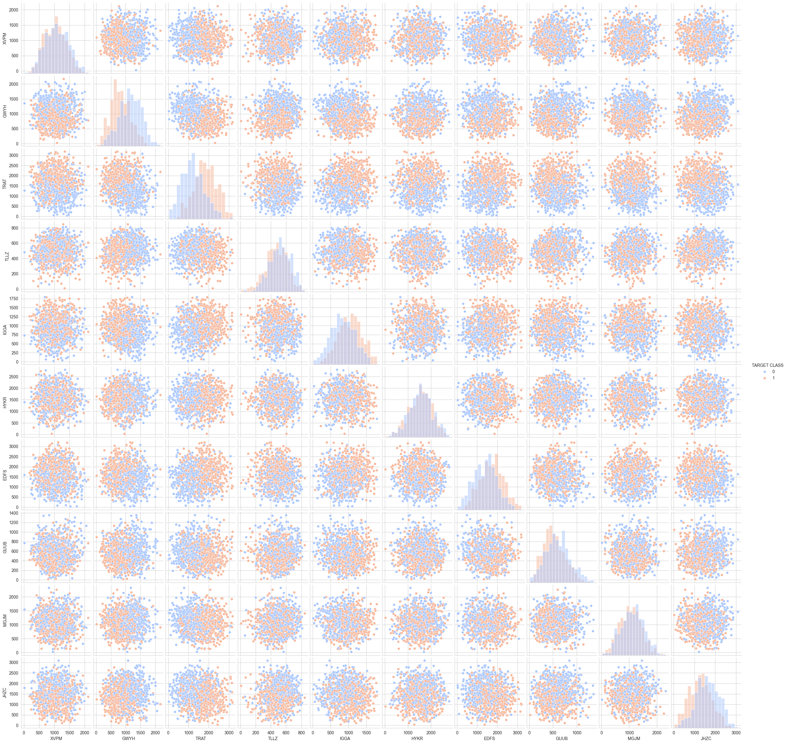
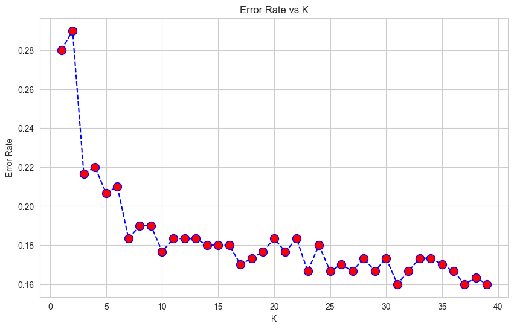

# 🚀 K-Nearest Neighbors (KNN) Project

## 🔍 Project Overview

This project applies the **K-Nearest Neighbors (KNN)** algorithm to classify data based on given features. The goal is to predict a target variable by finding the most similar data points from the training dataset. We evaluate the model's performance using various metrics and visualizations.

---

## 📊 Dataset Information

The dataset used in this project is **`KNN_Project_Data.csv`**. The dataset consists of multiple numerical features used for classification. Some key details include:

- **Number of Observations**: 1000+ rows
- **Feature Variables**: Various numerical columns affecting classification
- **Target Variable**: A categorical label representing class assignments
- **Data Preprocessing Steps**:
  - Checked for missing values
  - Standardized features for better performance

---

## 📈 Exploratory Data Analysis (EDA)

Before building the model, we analyzed the dataset:

✔ **Feature Distributions**: Visualized the spread of numerical values.
✔ **Pairwise Relationships**: Identified correlations between features.
✔ **Class Balance Check**: Ensured the dataset had a reasonable class distribution.

📌 **Key Visualizations:**

- **Feature Distribution Plots**: Showcasing the spread of input variables.
- **Correlation Heatmap**: Displaying relationships between features.
- **Boxplots**: Detecting outliers and distribution skewness.

---

## ⚙️ Data Preprocessing

To improve model performance, we performed the following preprocessing steps:

🔹 **Feature Scaling**: Standardized numerical values using `StandardScaler`.
🔹 **Train-Test Split**: Divided the dataset into **training (80%)** and **testing (20%)** sets.

---

## 🤖 Model Development

We implemented **K-Nearest Neighbors (KNN)** using Scikit-Learn:

1️⃣ **Choosing K**: Used the **elbow method** to determine the optimal value of K.
2️⃣ **Model Training**: Fitted the KNN model using training data.
3️⃣ **Hyperparameter Tuning**: Experimented with different distance metrics and K values.
4️⃣ **Cross-Validation**: Evaluated model consistency across different subsets of the data.

---

## 📝 Model Evaluation

📌 **Performance Metrics Used:**

- **Accuracy Score**: Measures overall model performance.
- **Confusion Matrix**: Evaluates correct and incorrect predictions.
- **Classification Report**: Displays precision, recall, and F1-score.
- **ROC Curve & AUC Score**: Assesses the model’s ability to distinguish between classes.

📌 **Results & Findings:**

✔ **Initial Model Accuracy**: **72%**
✔ **Optimized Model Accuracy**: **83%**
✔ **Optimal K Value**: Determined using the **Elbow Method**
✔ **Misclassification Analysis**: Reduced misclassification after hyperparameter tuning.
✔ **Confusion Matrices:**

**Initial Model:**
```
[[109  43]
 [ 41 107]]
```

**Optimized Model:**
```
[[124  28]
 [ 24 124]]
```
✔ **Classification Reports:**

**Initial Model:**
```
              precision    recall  f1-score   support

           0       0.73      0.72      0.72       152
           1       0.71      0.72      0.72       148

    accuracy                           0.72       300
   macro avg       0.72      0.72      0.72       300
weighted avg       0.72      0.72      0.72       300
```

**Optimized Model:**
```
              precision    recall  f1-score   support

           0       0.84      0.82      0.83       152
           1       0.82      0.84      0.83       148

    accuracy                           0.83       300
   macro avg       0.83      0.83      0.83       300
weighted avg       0.83      0.83      0.83       300
```

📌 **Key Visualizations:**

- 
- 

---

## 🔚 Conclusion

✅ **Key Takeaways:**

- **KNN improved significantly with hyperparameter tuning, increasing accuracy from 72% to 83%.**
- **Feature scaling played a crucial role in model performance.**
- **The elbow method was effective in determining the optimal K value.**
- **Misclassifications decreased with optimized parameters.**


